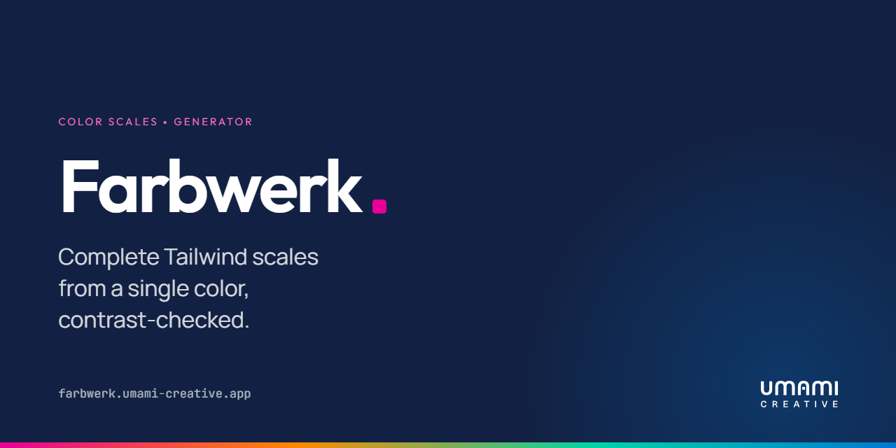

<p align="center">
  <a href="README.md">Deutsch</a> · <strong>English</strong>
</p>

# Farbwerk

**One color in, a whole Tailwind scale out.**

## What it is

Every project starts the same way: there is exactly one brand color. A hex code
from the styleguide. And then you sit there hand-mixing eleven Tailwind steps
until 300 and 400 look suspiciously alike and the button label on 500 is
beautiful but, sadly, unreadable.

Farbwerk gives you that afternoon back. Paste a color, and you get:

- **All eleven steps**, 50 through 950, computed in OKLCH — the way the eye
  actually perceives lightness, rather than the way sRGB likes to claim it does.
- **A secondary and tertiary color** via eight harmony rules — complementary,
  triadic, analogous and the rest. Change the primary and every linked role
  follows along.
- **Contrast, checked** for every pair, in both APCA and WCAG 2. Before the
  audit does it for you.
- **A gallery of real components** — dashboard, charts, forms, landing page —
  that repaints in your palette instantly. So you watch the colors do their job
  instead of admiring eleven swatches.
- **Colors pulled from an image**: drop in a logo, take the colors out. The
  image stays in your browser and is never uploaded anywhere.
- **Export** to seven formats (Tailwind 3 and 4, CSS, SCSS, SVG, Tokens Studio,
  W3C Design Tokens) in four notations. Copy, paste, carry on.

In short: the tool that takes you from a client's hex code to a finished
palette without losing accessibility on the way.

## Languages

Farbwerk speaks **English, German, French, Spanish and Italian**.

And then there are two nobody strictly needed:

- **Franconian** (`de-frk`) — because around here a palette is rightly called a
  „Balettn“ and the randomize button simply does „Glickssach“.
- **Klingon** (`tlh`) — because `rItlh tlhegh chenmoHwI'` is just the better
  name for a scale generator.

Both are translated in earnest and meant in jest. If you spot a string that is
still stubbornly English: pull requests welcome.

## Getting started

```bash
bun install
bun run dev
```

That's it. The app comes up on `http://localhost:3000`.

| Command | What it does |
| --- | --- |
| `bun run dev` | Development server |
| `bun run build` | Production build |
| `bun run test` | Tests |
| `bun run check` | Check linting and formatting |
| `bun run fix` | Fix both automatically |

Built with TanStack Start, React, Tailwind v4 and shadcn/ui. If you want to know
how the scales are built, why the base color is *not* forced to step 500, and
how the gallery repaints itself: [docs/internals.md](docs/internals.md).

---

A project by [Umami Creative GmbH](https://umami-creative.de).
