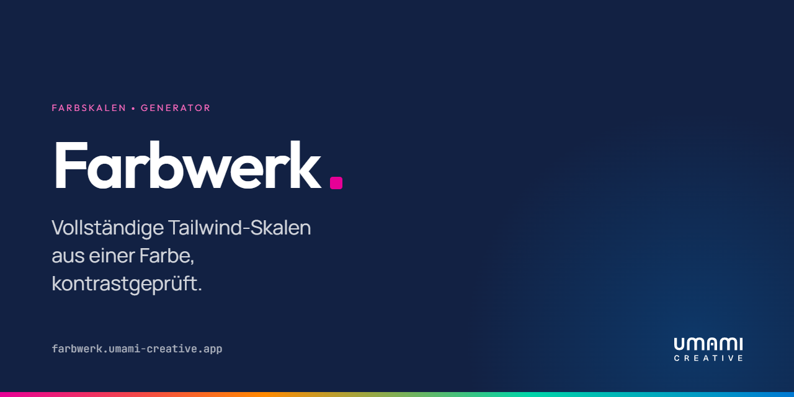

<a href="https://farbwerk.umami-creative.de">
  
</a>

<p align="center">
  <strong>Deutsch</strong> · <a href="README-EN.md">English</a>
</p>

<p align="center">
  <a href="https://farbwerk.umami-creative.de"><strong>farbwerk.umami-creative.de</strong></a><br>
  <sub>Live ausprobieren — ohne Anmeldung, ohne Installation</sub>
</p>

# Farbwerk

**Eine Farbe rein, eine ganze Tailwind-Skala raus.**

## Worum es geht

Jedes Projekt fängt gleich an: Es gibt genau eine Markenfarbe. Ein Hex-Code aus
dem Styleguide. Und dann sitzt man da und würfelt sich elf Tailwind-Stufen
zusammen, bis 300 und 400 verdächtig ähnlich aussehen und der Button-Text auf
500 zwar hübsch ist, aber leider unlesbar.

Farbwerk nimmt Ihnen genau diesen Nachmittag ab. Farbe einfügen, fertig:

- **Alle elf Stufen** von 50 bis 950, berechnet in OKLCH — also so, wie das
  Auge Helligkeit tatsächlich wahrnimmt, und nicht so, wie sRGB das gerne
  behauptet.
- **Zweite und dritte Farbe** über acht Harmonieregeln — komplementär,
  triadisch, analog und so weiter. Ändern Sie die Hauptfarbe, ziehen alle
  anderen mit.
- **Kontrast wird geprüft**, jedes Paar, nach APCA und WCAG 2. Bevor es das
  Audit tut.
- **Eine Galerie echter Komponenten** — Dashboard, Charts, Formulare, Landing
  Page — die sich sofort in Ihrer Palette neu einfärbt. Man sieht die Farben
  also arbeiten, statt nur elf Kacheln zu bewundern.
- **Farben aus einem Bild ziehen**: Logo reinwerfen, Farben rausholen. Das Bild
  bleibt dabei im Browser und wird nirgendwohin hochgeladen.
- **Export** in sieben Formate (Tailwind 3 und 4, CSS, SCSS, SVG, Tokens Studio,
  W3C Design Tokens) in vier Notationen. Copy, paste, weiterarbeiten.

Kurz: das Werkzeug, mit dem man vom Kunden-Hex zur fertigen Palette kommt,
ohne unterwegs die Zugänglichkeit zu verlieren.

## Sprachen

Farbwerk spricht **Deutsch, Englisch, Französisch, Spanisch und Italienisch**.

Und dann sind da noch zwei, die es fachlich nicht gebraucht hätte:

- **Fränkisch** (`de-frk`) — weil eine Palette hier zu Recht „Balettn“ heißt und
  der Zufallsgenerator schlicht „Glickssach“ macht.
- **Klingonisch** (`tlh`) — weil `rItlh tlhegh chenmoHwI'` einfach der bessere
  Titel für einen Skalengenerator ist.

Beide sind ernst gemeint übersetzt, nur eben nicht ernst zu nehmen. Wer eine
Stelle findet, die noch Hochdeutsch ist: Pull Request willkommen.

## Loslegen

```bash
bun i
bun run dev
```

Das war's. Die App läuft dann auf `http://localhost:3000`. Wer nur schnell
Farben braucht, spart sich das und geht auf
[farbwerk.umami-creative.de](https://farbwerk.umami-creative.de).

| Befehl | Wofür |
| --- | --- |
| `bun run dev` | Entwicklungsserver |
| `bun run build` | Produktions-Build |
| `bun run test` | Tests |
| `bun run check` | Linting und Formatierung prüfen |
| `bun run fix` | Beides automatisch korrigieren |

Gebaut mit TanStack Start, React, Tailwind v4 und shadcn/ui. Wer wissen will,
wie die Skalen entstehen, warum die Basisfarbe *nicht* auf Stufe 500 gezwungen
wird und wie sich die Galerie neu einfärbt: [docs/internals.md](docs/internals.md).

---

Ein Projekt der [Umami Creative GmbH](https://umami-creative.de).
